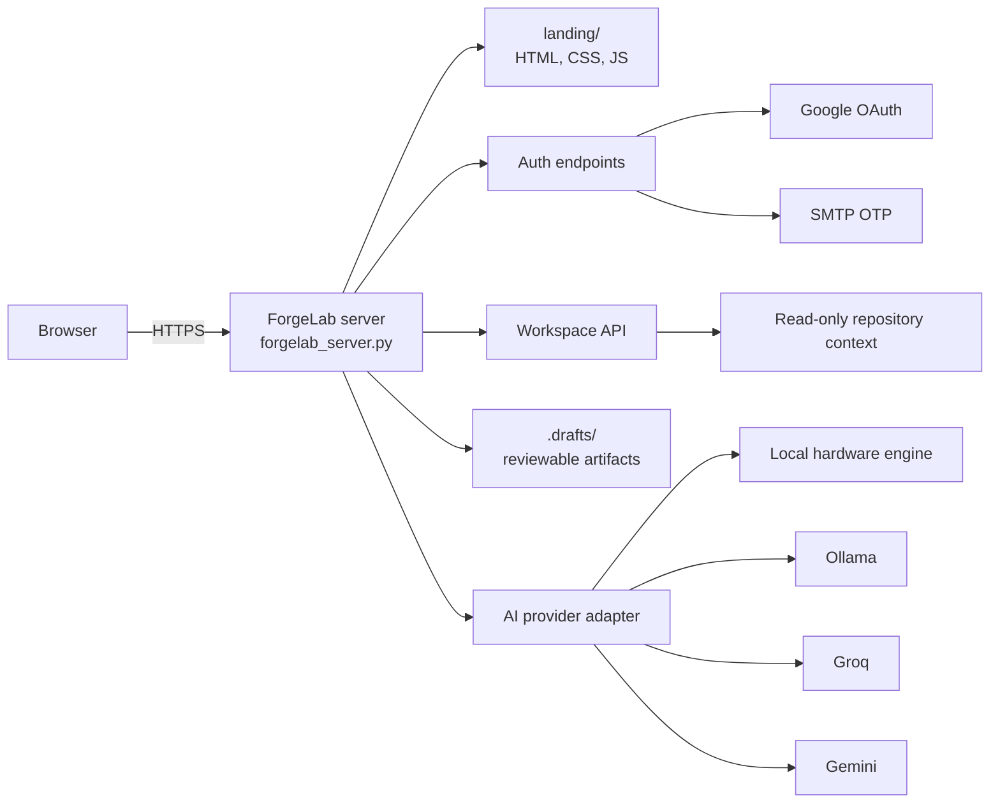
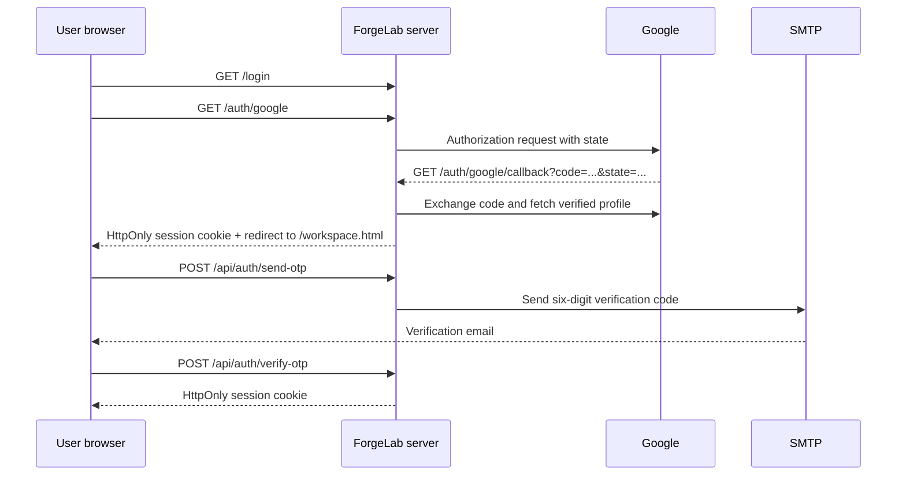
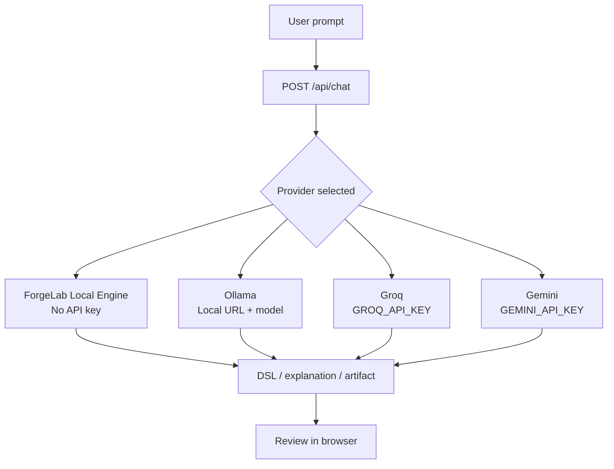
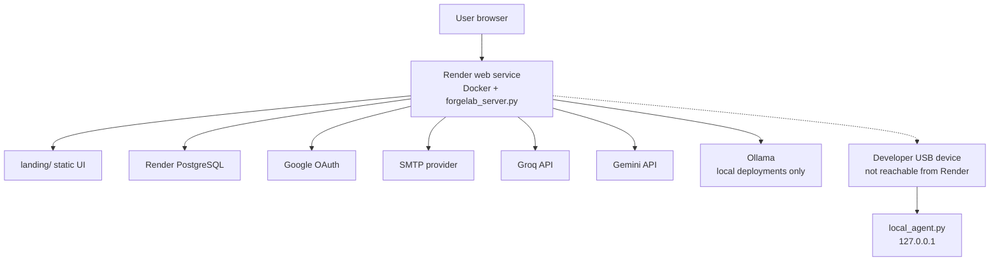
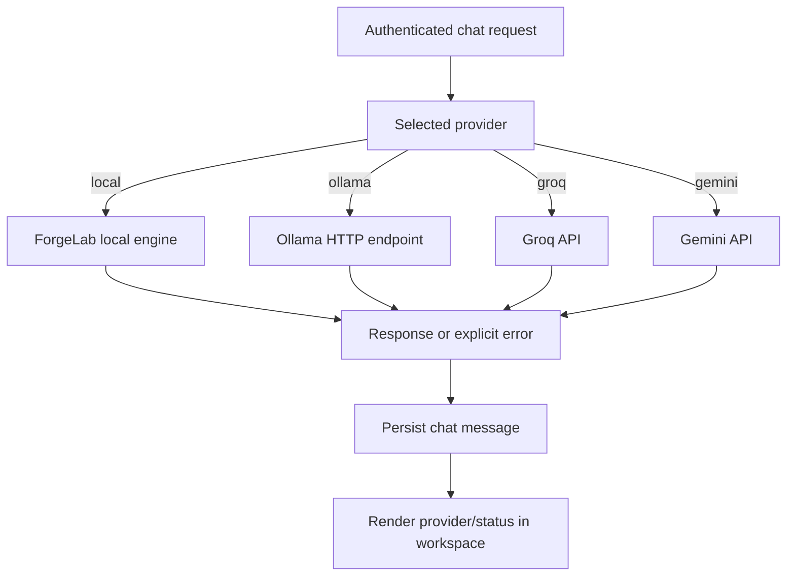
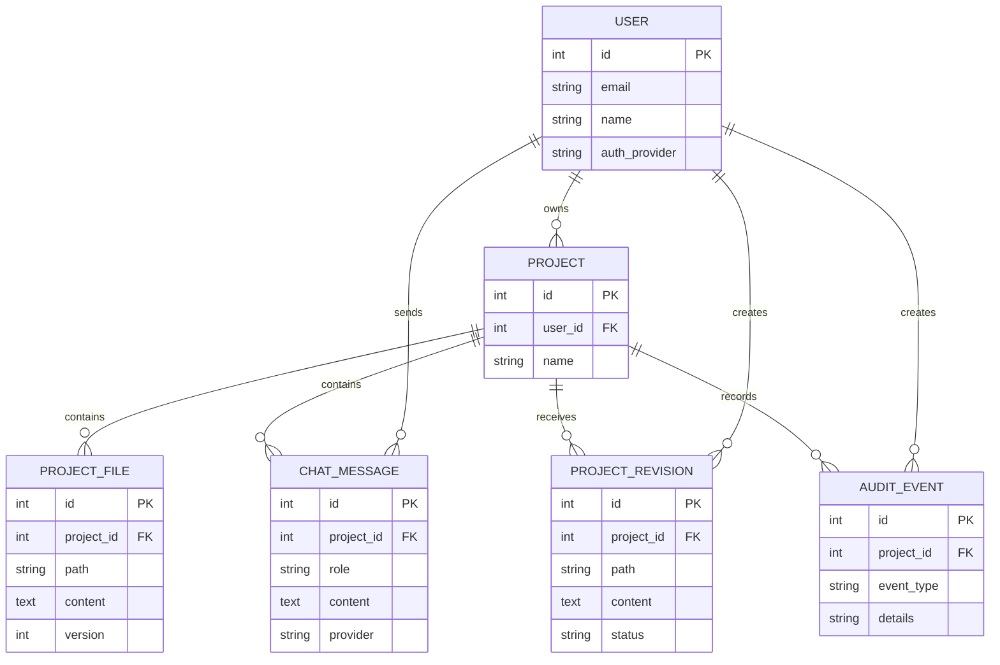
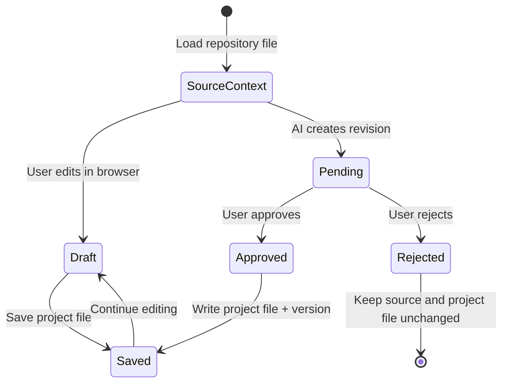
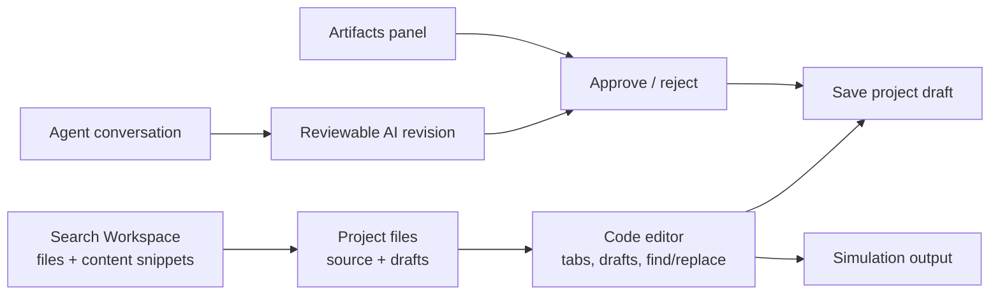
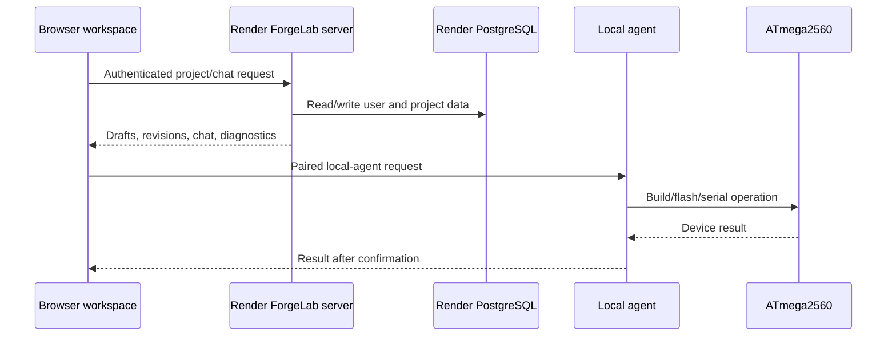

# ForgeLab / SpectraSoft

ForgeLab is an AI-assisted engineering workspace for inspecting spectroscopy
firmware context, simulating safe control sequences, and generating reviewable
draft artifacts. The repository also contains the standalone SpectraSoft
industrial-control desktop application.

## Architecture

The web deployment is intentionally a single service: one Python process serves
the public pages, authentication endpoints, workspace API, and AI-provider
proxy. Provider credentials stay on the server and are never embedded in the
browser bundle.



### Request and authentication flow



Unauthenticated requests to `/workspace.html` are redirected to `/login`.
OAuth state is single-use and expires after ten minutes. Sessions expire after
seven days.

### AI-provider routing



## Deploy ForgeLab

ForgeLab is deployable as one Docker container. The Python server listens on
`0.0.0.0:$PORT`; Render supplies `PORT=8000` through [render.yaml](render.yaml).

### Local production-like run

1. Copy `.env.example` to `.env` and fill in provider/auth values. Use a
   Google **App Password** for `SMTP_PASSWORD`, not the Gmail account password.
2. In Google Cloud Console, create a Web OAuth client and add
   `http://localhost:8765/auth/google/callback` as an authorized redirect URI.
3. Start the server:

   ```powershell
   .\.venv\Scripts\python.exe forgelab_server.py
   ```

4. Open `http://localhost:8765/login`.

The landing page is available at `http://localhost:8765/`; the protected
workspace is at `http://localhost:8765/workspace.html`.

### Free deployment

Render can deploy the included [render.yaml](render.yaml) and [Dockerfile](Dockerfile)
on its free web service:

1. Push the repository to GitHub, including `render.yaml` and `Dockerfile`.
2. In Render, choose **New → Blueprint**, select the repository, and apply the
   blueprint.
3. Set `FRONTEND_URL` to the public Render URL, for example
   `https://daq-project.onrender.com`.
4. Set `GOOGLE_REDIRECT_URI` to
   `https://daq-project.onrender.com/auth/google/callback`.
5. Add that exact callback URL to the Google OAuth client.
6. Enter secrets in Render's environment settings and redeploy.

Open the deployed login page at:

```text
https://daq-project.onrender.com/login
```

Never commit `.env`, API keys, OAuth secrets, SMTP passwords, or session
secrets. If a secret is exposed, revoke it and create a replacement.

If a Groq key was pasted into an editor, screenshot, chat, or issue, treat it
as compromised even if the file is ignored by Git. Revoke it in the Groq
console, create a replacement, update local `.env` and Render secret
variables, and hard-refresh/redeploy the service.

### Deployment environment

| Variable | Local example | Render value |
| --- | --- | --- |
| `PORT` | `8765` by default | `8000` |
| `FRONTEND_URL` | `http://localhost:8765` | `https://<service>.onrender.com` |
| `GOOGLE_REDIRECT_URI` | `http://localhost:8765/auth/google/callback` | `https://<service>.onrender.com/auth/google/callback` |
| `SMTP_USERNAME` / `SMTP_PASSWORD` | Gmail account / App Password | Render secret variables |
| `GROQ_API_KEY` / `GEMINI_API_KEY` | Optional | Render secret variables |

### Render deployment topology



Render can host the web service and PostgreSQL database, but it cannot access
an ATmega2560 connected to a user's laptop. Device builds, serial communication,
and flashing require the local agent on the machine that owns the USB device.

### AI providers

- **ForgeLab Local Engine** is always free and requires no key.
- **Ollama** is free locally: install Ollama and pull `llama3.2`.
- **Gemini** has a free API tier in eligible regions; set `GEMINI_API_KEY`.
- **Groq** offers a free developer tier with rate limits; set `GROQ_API_KEY`.

The provider selector exposes local, Ollama, Groq, and Gemini. Keep provider
keys on the server and do not send them from browser code.

### Provider failure and fallback behavior

The selected provider is attempted first. The server returns provider failures
in the chat response instead of silently presenting a local response as if it
came from the selected cloud provider. The local ForgeLab engine can still be
selected explicitly for deterministic, hardware-aware behavior.



Hosted providers are subject to model availability, request limits, and token
limits. Use a model returned by the provider's models endpoint and keep
prompts/context compact on free tiers.

## Full web-system architecture

The web application uses a separate persistence layer in
[web_database.py](web_database.py). It uses Render PostgreSQL when
`DATABASE_URL` is present and a local `web.db` SQLite fallback for development.
The existing [core/database.py](core/database.py) remains the desktop
application's SQLite database.

The web database stores:

- OAuth/OTP users and profile fields (`avatar_url`, `bio`, `education`, and
  `personal_background`)
- Projects and project ownership
- Project files and revision metadata
- AI chat messages linked to the user and project
- Audit-event records for future device/build operations



### Project-file and revision lifecycle

Authoritative repository files are read-only context. User edits and AI output
are project drafts. An AI revision becomes a project file only after approval;
rejection records the decision without changing the file.



The relevant API surface is:

| Purpose | Endpoint |
| --- | --- |
| List projects | `GET /api/projects` |
| Create project | `POST /api/projects` |
| Load project files | `GET /api/project-files?project_id=<id>` |
| Save project file | `POST /api/project-files` |
| List revisions | `GET /api/project-revisions?project_id=<id>` |
| Create AI revision | `POST /api/project-revisions` |
| Approve revision | `POST /api/project-revisions/<id>/approve` |
| Reject revision | `POST /api/project-revisions/<id>/reject` |
| Load chat history | `GET /api/chat/history?project_id=<id>` |

### Browser workspace layout

The workspace is a native HTML/CSS/JavaScript IDE surface. It includes a
project file tree, editable draft editor, reviewable artifacts,
activity/simulation output, and an authenticated agent conversation.



The workspace supports runtime resizing for the project file sidebar,
editor/agent split, artifacts/activity/simulation panel, and agent conversation.
Resize values are stored in browser `localStorage`. On small screens, handles
are disabled and the layout switches to a stacked view. `Ctrl/Cmd+P` opens
Search Workspace; it searches file names and project-file content, fetching
unloaded content from the backend when available.

For local hardware, run [local_agent.py](local_agent.py) on the computer with
the ATmega2560 connected:

```powershell
$env:FORGELAB_AGENT_TOKEN = "generate-a-long-random-token"
.\.venv\Scripts\python.exe local_agent.py
```

The agent listens only on `127.0.0.1`. It supports a build command and requires
`confirm_flash=true` for a firmware upload. A browser/cloud integration should
pair an authenticated user to this agent before sending commands; the Render
server cannot directly access a user's USB port.



The cloud service cannot reach USB devices attached to a developer's computer.
Keep `local_agent.py` bound to `127.0.0.1`, use a long random
`FORGELAB_AGENT_TOKEN`, and require explicit confirmation before flashing.

AI chat is now authentication-protected and persisted. File writes and device
flashing should remain approval-based: the production IDE must show a diff,
record the approval, and then send a command to the local agent.

## Standalone Industrial Control Builder

Launch the standalone app from the repository root:

```powershell
.\.venv\Scripts\python.exe standalone_main.py
```

It opens independently of SpectraSoft and targets
the supplied ATmega2560 O/A/B/I/T firmware without editing or flashing its
`.ino` source. See [STANDALONE_README.md](STANDALONE_README.md) for setup and
hardware details. Simulation is the default; live actions require confirmation.

The standalone app also has a **Generate Artifact** tab for user-directed
drafts of Python, Arduino, C++, Markdown, JSON, CSV templates, SVG, and text
files. Generated text is reviewable/editable, saved as a new file, and never
executed or flashed by the app. The original firmware remains unchanged.

### ForgeLab local workspace

ForgeLab is an optional browser workspace for inspecting the real project
context and creating reviewable AI drafts:

```powershell
.\.venv\Scripts\python.exe forgelab_server.py
```

Open `http://127.0.0.1:8765/`. The server keeps Groq credentials local,
proxies Ollama or Groq requests, maps `firmware.ino` to the authoritative
`firmware/src/main.cpp`, and never writes source files or executes hardware
actions. Uploads and generated artifacts remain reviewable browser drafts.

## Industrial Control Builder

Open **Industrial Control → AI Control Builder** from the desktop app. The first implementation supports:

- Groq hosted planning (`GROQ_API_KEY`, optional `GROQ_MODEL`) or a local Ollama endpoint (`OLLAMA_URL`, `OLLAMA_MODEL`). Install Ollama, download a model, and leave its local server running; default model is `llama3.2`.
- Document context from TXT, JSON, CSV, XLSX/XLSM, DOCX, PDF, and image references. PDF text extraction uses `pypdf`; Excel analysis uses `openpyxl`. Images are currently recorded as references only; OCR/vision extraction is not implemented.
- Compact, allow-listed DSL plans. The model does not create or execute Python. Plans are validated locally, displayed for editing, and hardware execution asks for approval.
- CSV and Excel numeric-table analysis using deterministic filters, calibration, statistics, regressions, derivatives, integration, and peak detection. Select Y and optional X columns in the page.
- PlatformIO build and explicitly confirmed firmware upload for the workspace firmware project.

Install the added document-analysis packages with `python -m pip install -r requirements.txt`. For Groq, set `GROQ_API_KEY` in the environment before starting the application. For Ollama, configure `OLLAMA_MODEL` to a model already installed locally.

### Firmware compatibility

The builder's live execution and PlatformIO upload target `firmware/`, which implements `PIN`, `W`, `SEQ_ADD`, `SEQ_RUN`, and related commands. The spectroscopy sketch supplied separately uses `O,<port>,<hex>`, `I`, and `T`; it does not implement the sequence-buffer commands. Those firmware protocols are not interchangeable. The UI calls out the required protocol before live use. Do not upload or execute against a board until the installed firmware and selected COM port are confirmed.

The builder currently compiles fixed workspace firmware; it does not let the LLM rewrite firmware source. Firmware changes should be reviewed in code and rebuilt before upload.

This document outlines the recent modifications made to the SpectraSoft application to address display sizing, data formatting, and High Voltage (HV) channel addressing issues.

## 1. CSV Data Storage Organization by Channel

**What:** 
The mock data storage format in `sequence_data.csv` was restructured to use the hardware channel number (ITG number) as the primary index rather than the element name. The CSV reader and exporter were updated to handle this new layout.

**Where:**
- `sequence_data.csv`: Added `Channel No` as the primary key column (first column).
- `core/csv_override.py`: Refactored `load_st_values()` and `list_st_numbers()` to natively parse the new channel-based format while gracefully supporting the legacy element-based format.
- `ui/analysis/analysis_run_job5.py`: Updated the `_on_export` CSV writing routine to export data strictly ordered and keyed by `Channel No`.

**Why:**
Relying on element names as primary identifiers can cause issues if element names change or if multiple channels refer to variations of the same element. Re-orienting the logic around physical channel numbers tightly aligns the software's data structures with the physical architecture of the hardware.

## 2. High Voltage (HV) HEX Address System

**What:** 
Implemented a dedicated High Voltage controller module to process UART commands properly with exact hexadecimal formatting.

**Where:**
- `core/hv_controller.py` **[NEW]**: Created a robust controller dedicated to sending proper `O,A,<hex_addr>` commands over UART for HV channels.
- `core/sequence_engine.py` & `core/attenuator_programmer.py`: Added explicit inline documentation defending the Python format `{:02X}` syntax.
- *Note on UI Hook:* The integration hook inside `ui/main_window.py` (which connected the UI's HV toggle button to this controller) was previously implemented but appears to have been recently reverted in your editor, reverting it back to a software simulation toggle.

**Why:**
Channels 10–15 mathematically map to hex addresses `09–0E`. There was an issue where hex values `0A` through `0E` (containing characters A-F) could be mistakenly identified as invalid if processed by decimal-only validators. The new controller strictly isolates and handles these values properly as strings.

## 3. Display Form & Frame Resizability

**What:**
Modified the application's root window to allow the user to resize and maximize the desktop application interface.

**Where:**
- `ui/main_window.py` *(Note: This change appears to have been recently reverted back to `setFixedSize(1100, 680)` in your editor)*.

**Why:**
The application interface was hardcoded using `self.setFixedSize()`, preventing any manual adjustment. Migrating to `self.setMinimumSize()` allows the inner layouts to dynamically stretch/shrink natively using Qt layout properties, granting better accessibility across different monitor resolutions.
